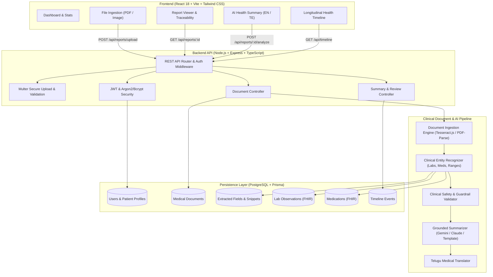

# MyHealthIO — System Architecture & Workflow

## 1. System Overview

MyHealthIO is an AI-powered personal health copilot designed to empower patients to ingest, understand, and organize their personal health documents. It combines secure multi-tenant cloud storage, multi-modal clinical text extraction, safety-guarded explainability in English and Telugu, and FHIR-aligned longitudinal health timelines.

---

## 2. Architecture Diagram

---

## 3. Core Workflow Architecture

1. **Upload & Sanitation**:
   - The user selects a medical PDF or PNG/JPG image.
   - Client performs MIME and size validation before payload dispatch.
   - Express server checks authorization, verifies content magic-bytes, and writes the file to a secure, unindexed storage volume.
2. **Text Parsing & OCR**:
   - PDF files are parsed directly via stream text extraction; scanned images or embedded bitmaps trigger Tesseract OCR.
   - Text is normalized into numbered line tokens with confidence scores.
3. **Traceable Extraction & Grounding**:
   - Regex and clinical entity extractors parse test parameters, numerical outputs, metric units, and laboratory reference ranges.
   - Every single extracted attribute retains the exact string snippet and character span of its source line in the document.
4. **Safety Verification & Plain-Language Explanation**:
   - Pre-summary filter confirms no prescriptive actions or hallucinated diagnoses exist.
   - Summarizer produces patient-accessible explanations and key clinical observations.
   - Telugu translation provides vernacular accessibility while retaining original units and measurements.
5. **Interactive Review & Persistence**:
   - The user reviews extracted values side-by-side with source snippets.
   - Confirmed records generate longitudinal FHIR-aligned observations (`LabObservation`, `MedicationRecord`, `TimelineEvent`).
